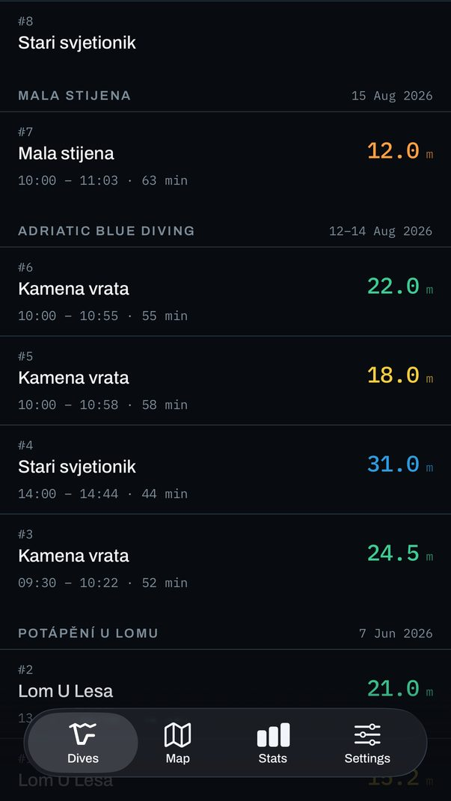
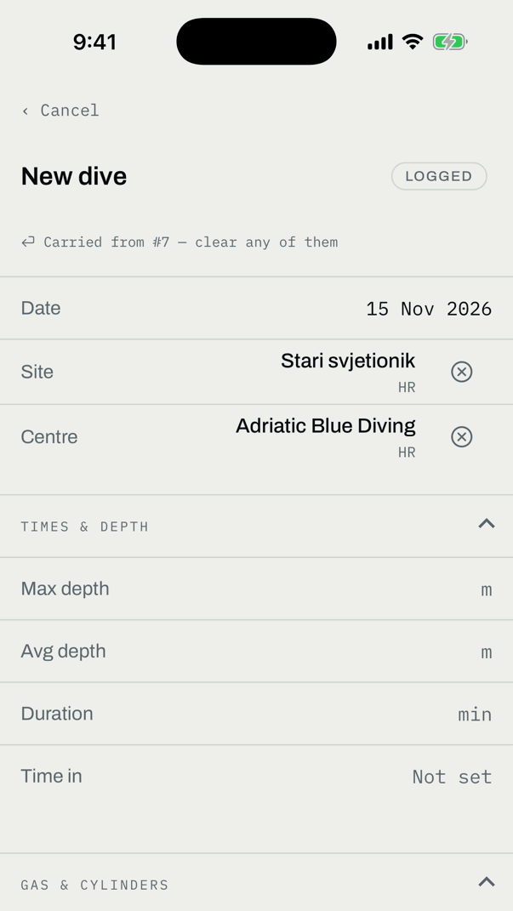
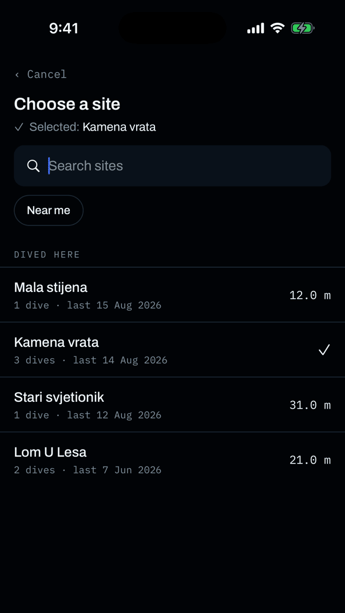
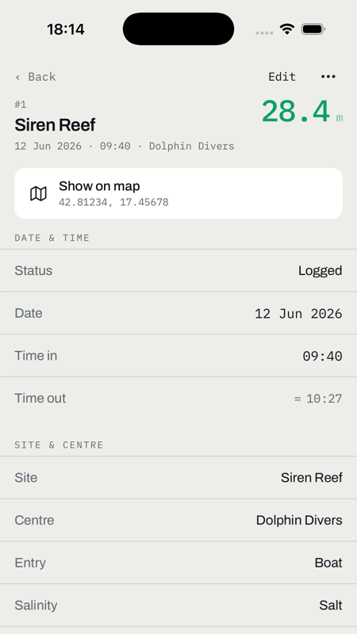
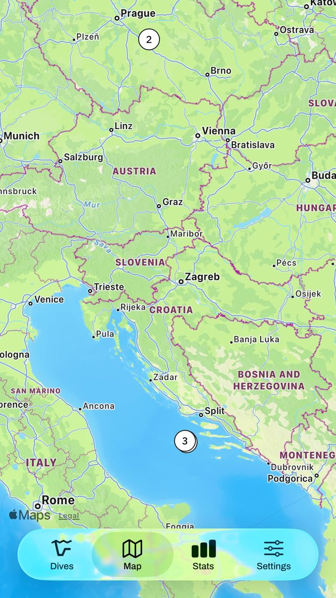
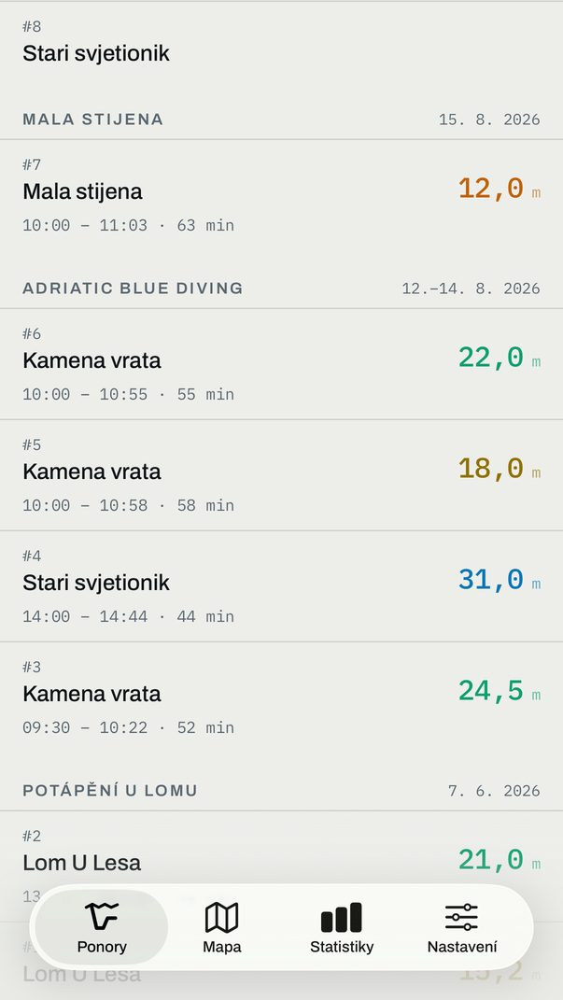
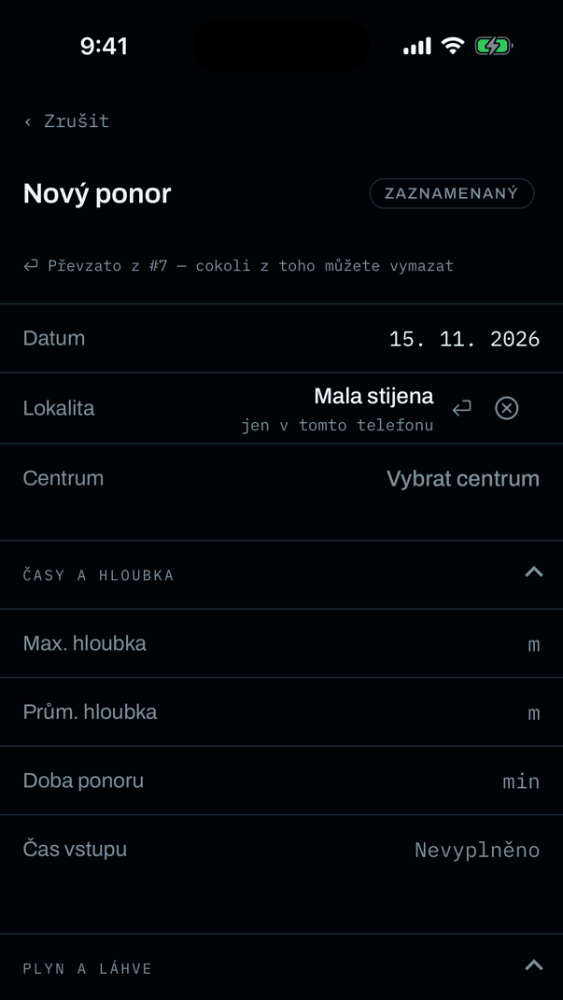
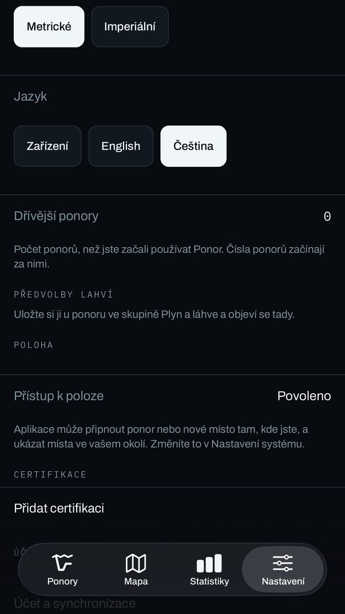

# Ponor

A free, offline-first dive log that *fills itself in*: after the first dive of a trip, you only touch what changed.

> **ponor**: in Czech, the submersion itself, how deep a thing sinks. In English, the karst opening where a surface stream leaves the daylight and becomes an underground river.

| Dives | New dive | Choose a site | A dive |
|---|---|---|---|
|  |  |  |  |

| Map | Ponory (Czech) | Nový ponor | Nastavení |
|---|---|---|---|
|  |  |  |  |

<sub>iPhone simulator, invented demo dives.</sub>

## What it does

- **Logs a dive in a few taps.** A new dive starts from the last one: site, centre, entry, water, cylinders and gas, weights, suit, equipment, buddy and guide carry over, each easy to clear. Only the date is required.
- **Plans ahead.** Prepare a dive before you go and complete it afterwards.
- **Groups itself into trips.** There is no trip to create: the list groups dives by centre and date, and numbers them for you, counting the dives you logged before Ponor.
- **Shares sites and centres.** Pick a site from the ones you have dived, search the community catalogue, or find what is near you. A new site is checked against existing ones before it is saved.
- **Maps your dives** by site, with community sites and dive centres as layers you can switch on.
- **Imports from a dive computer.** Suunto's JSON export is read so far. An imported dive shows its depth profile and gas consumption. A profile is only ever drawn from recorded samples, never made up from max depth and duration.
- **Keeps the rest:** statistics, a certification wallet, CSV and JSON export, metric or imperial units, English and Czech, dark and light themes.
- **Works at sea.** Everything runs from a database on the phone. An account (email sign-in) is optional and only needed to back up, sync and share sites.

**Colour means depth, and nothing else.** Water takes away red first and blue last, so the depth colours run from red at the surface to indigo past 40 m. Every control stays monochrome.

**Status:** not in the app stores yet. The v1 release is tracked in [#22](https://github.com/alesdvorakcz/ponor/issues/22), and open work is in [the issues](https://github.com/alesdvorakcz/ponor/issues).

## How it's built

- [Expo](https://expo.dev) and React Native in TypeScript, with `expo-router`. It runs as a development build, not in Expo Go.
- `expo-sqlite` with Drizzle on the device: the local database is the source of truth.
- react-hook-form and Zod for the dive form; react-native-maps; react-native-svg for profiles; i18next for English and Czech.
- [Supabase](https://supabase.com) for accounts, Postgres with PostGIS, and the sync functions in [`supabase/`](supabase/README.md).

[DESIGN.md](DESIGN.md) is the plan and the record. [§0](DESIGN.md#0-name--visual-identity) has the name, palette and theme tokens, [§9](DESIGN.md#9-milestones) what is built and what is left, and [§10](DESIGN.md#10-decision-log) why each decision was made.

## Running it

You need Node 22 (see `.nvmrc`) and, for iOS, Xcode with an iOS simulator runtime.

```bash
npm ci          # also applies patches/ (see patches/README.md)
npm run ios     # builds the development build, installs it on a simulator and starts Metro
```

After the first build, `npm start` is enough until native code changes. `npm run android` is the Android equivalent; day-to-day checking happens on iOS.

The app needs no configuration: without a backend it logs dives offline, and every test passes. To try accounts and sync, copy `.env.example` to `.env` and set `EXPO_PUBLIC_SUPABASE_URL` and `EXPO_PUBLIC_SUPABASE_ANON_KEY` for your own Supabase project, with the migrations in [`supabase/`](supabase/README.md) applied. `.env.example` explains which key belongs there and which never does.

The checks CI runs:

```bash
npm run typecheck && npm run lint && npm test -- --ci
```
